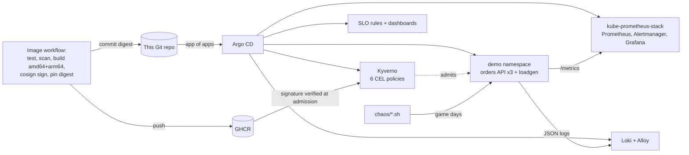

# KubeOps SRE Lab

[](https://github.com/ObaidAbdullah16/kubeops-sre-lab/actions/workflows/ci.yml)
[](https://github.com/ObaidAbdullah16/kubeops-sre-lab/actions/workflows/e2e.yml)
[](https://github.com/ObaidAbdullah16/kubeops-sre-lab/actions/workflows/image.yml)


**A Kubernetes platform you can run on a laptop with one command, then break on
purpose: GitOps with Argo CD, policy-as-code with Kyverno, Prometheus + Grafana +
Loki observability, SLOs with multi-window burn-rate alerts, and four scripted
game days with runbooks and postmortems.**

> **Simulated incidents.** All outages in this lab are injected on purpose by `chaos/*.sh` against a
> demo service with synthetic traffic - nothing here is a real production system.

Free on your laptop (kind). Optional "demo day" on AWS EKS for ~$0.15-0.35/hour (spot nodes in a classic account, on-demand t4g.medium in a new-sign-up project account, c7i-flex.large while that account is still on the AWS Free plan).

## What is inside



| Area | What it shows |
|---|---|
| **GitOps** | Argo CD *app of apps* with sync waves; everything in the cluster comes from `gitops/`. Exact Helm chart versions, values in Git, self-heal on drift. |
| **Supply chain** | The demo image is built for amd64 + arm64, scanned (Trivy), pushed to GHCR with SBOM + provenance, **signed with keyless cosign**, and its digest committed back to Git. |
| **Policy as code** | Kyverno 1.19 `ValidatingPolicy` / `ImageValidatingPolicy` (CEL): requests/limits, probes, restricted security context, no `:latest`, allowed registries, **signature verification**. Unit-tested with `kyverno test`. |
| **Observability** | Prometheus scraping a Go service with RED metrics, Loki logs via Alloy (Kubernetes API, no privileged DaemonSet), Grafana dashboards generated from code. |
| **SLOs** | 99.5% availability / 99% under 300 ms. Recording rules for 7 windows, Google SRE Workbook multi-window multi-burn-rate alerts, **unit-tested with promtool**. |
| **Reliability** | 3 replicas spread over 2 workers, readiness/liveness probes, graceful shutdown, PodDisruptionBudget, Pod Security Admission `restricted`. |
| **Game days** | Error spike, latency regression, pod/node failure, blocked insecure deploy - each with expected signals, response steps and a postmortem. |
| **CI** | Go tests, policy tests, SLO tests, kubeconform with CRD schemas, `helm template` of every chart with our values, Terraform/checkov, shellcheck, actionlint, zizmor, and an **e2e test in kind** on every push. |

## Quick start (laptop, free)

Needs Docker Desktop (6 GB+ memory for Docker), `kind`, `kubectl`, `helm`, `git`
(`_setup/install-tools-wsl.sh` in the parent folder installs them in WSL).

```bash
bash scripts/up.sh        # ~10 minutes the first time (pulls images)
bash scripts/status.sh
bash scripts/down.sh      # deletes the cluster (keeps the ~1 GB kind node image for a fast restart)
bash scripts/down.sh --all   # also deletes that image
```

| UI | URL | Login |
|---|---|---|
| Argo CD | http://localhost:8090 | `admin` / printed by `up.sh` |
| Grafana | http://localhost:3000 | `admin` / `kubeops-lab` → Dashboards → KubeOps |
| Prometheus | http://localhost:9090 | |
| Alertmanager | http://localhost:9093 | |
| Demo API | http://localhost:8081/api/orders | |

> The demo app needs a signed image. After you publish the repository, the
> **Image** workflow builds, signs and pins it automatically (one push). Until then
> everything else comes up and the `demo` application waits.

## Game days

```bash
bash chaos/error-spike.sh 0.15   # GD-01: watch the burn-rate alert fire
bash chaos/latency.sh 400 0.3    # GD-02
bash chaos/kill-pods.sh 2        # GD-03
bash chaos/node-failure.sh 180   # GD-03
bash chaos/bad-deploy.sh         # GD-04: Kyverno rejects insecure / unsigned images
bash chaos/reset.sh
```

Runbooks: [gamedays/](gamedays/README.md) · Postmortems:
[GD-01](gamedays/example-postmortem-GD-01.md), [GD-02](gamedays/example-postmortem-GD-02.md),
[GD-03](gamedays/example-postmortem-GD-03.md)

Next steps I would add: distributed tracing (OpenTelemetry SDK in the app + Grafana
Tempo), and Argo Rollouts canary releases gated on the same SLO queries.

## Optional: EKS demo day (~$0.15-0.35/hour)

Uses the shared AWS setup from `aws-foundation` (state bucket, budgets, OIDC role).

```bash
bash scripts/eks-up.sh       # VPC + EKS + 2 nodes + the same GitOps stack (~20 min)
bash scripts/eks-status.sh
bash scripts/eks-down.sh     # destroy everything
```

Or from the Actions tab: **EKS (optional)** → `up` / `status` / `down`. The nightly
**Auto-stop EKS** workflow destroys a forgotten cluster at 00:00 IST.

## Repository layout

```
app/                    Go demo service: orders API + load generator, chaos knobs, /metrics
bootstrap/              Argo CD Helm values (installed by scripts/up.sh)
gitops/root/            app of apps (Helm chart of Argo CD Applications, sync waves)
gitops/platform/        values for kyverno, kube-prometheus-stack, loki, alloy (+ eks/ overrides)
gitops/policies/        Kyverno CEL policies
gitops/observability/   SLO PrometheusRule + Grafana dashboards (generated by tools/dashboards.py)
gitops/apps/demo/       demo Deployment, Service, ServiceMonitor, PDB, loadgen (kustomize)
chaos/                  game-day fault injection scripts
gamedays/               runbooks, postmortem template, example postmortem
tests/                  kyverno policy tests, promtool SLO tests, e2e overlay
infra/eks/              optional EKS cluster (Terraform)
scripts/                up / down / status, eks-up / eks-down / eks-status, ci-tools
kind/cluster.yaml       3-node kind cluster with ports on 127.0.0.1
```

## Design decisions

| Decision | Why |
|---|---|
| kind for daily use, EKS only for demos | Free, fast to rebuild, identical GitOps definitions (`profile: kind|eks`) |
| Argo CD app of apps + Helm `$values` refs | Upstream charts stay untouched; only our values live in Git |
| Kyverno CEL policies (`policies.kyverno.io/v1`) | `ClusterPolicy` is deprecated in Kyverno 1.19; CEL is also what Kubernetes `ValidatingAdmissionPolicy` uses |
| Policies only in labelled namespaces | Platform components are not blocked by app-level rules; explicit opt-in per namespace |
| Chaos settings in a ConfigMap outside Git | Simulates a real "someone changed config in prod" incident that Argo CD does not revert |
| Alloy via Kubernetes API | No hostPath mounts or privileged DaemonSet for log collection |
| SLO alerts unit-tested | Alert logic is code; a typo should fail CI, not stay silent during an incident |

## License

MIT
